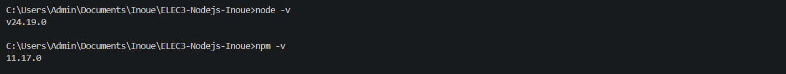
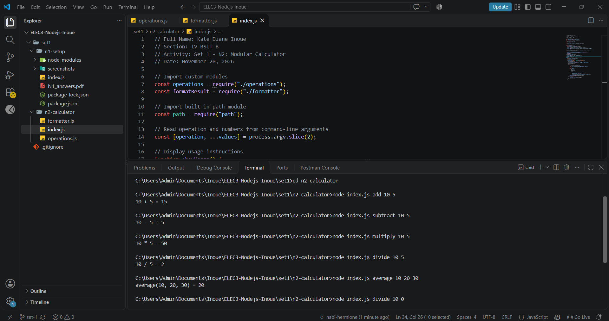
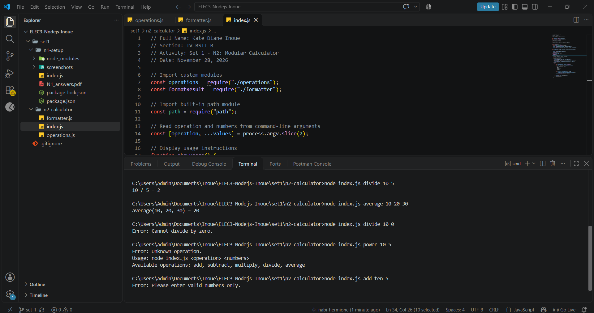
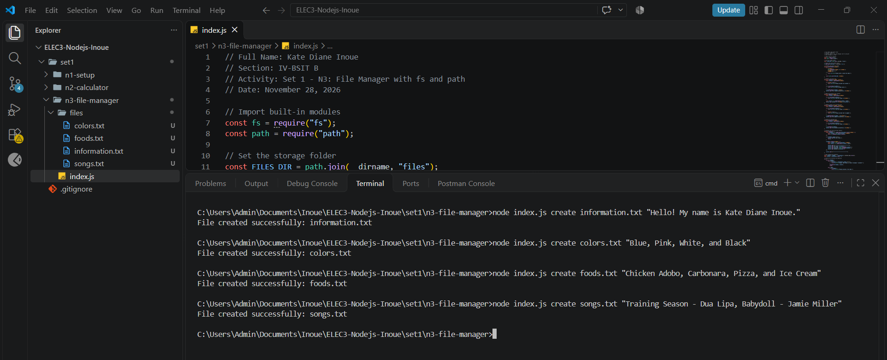
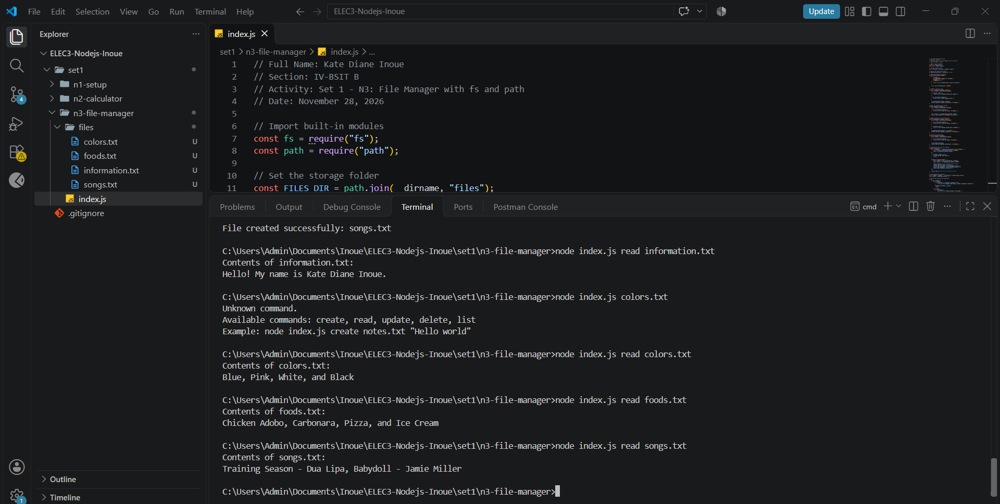
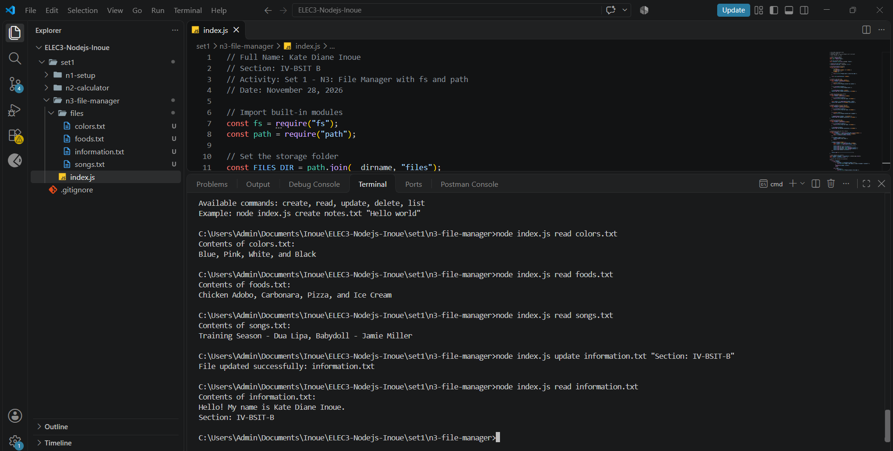
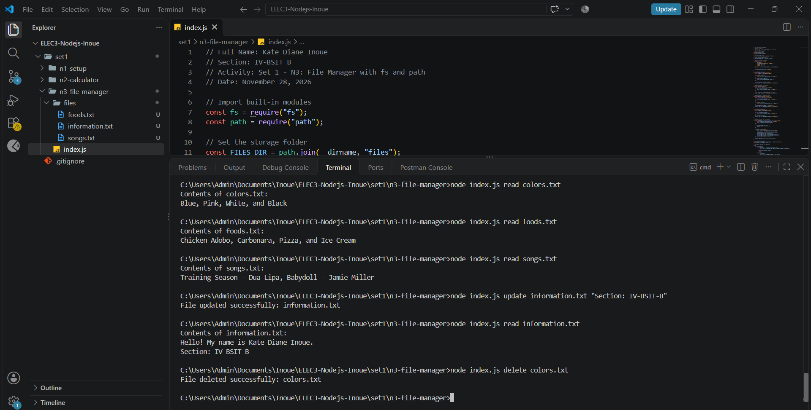
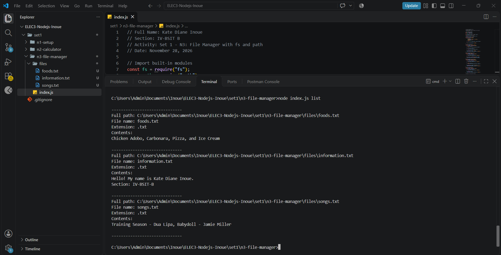

# ELEC 3 – Node.js Activities

## Prepared By:

**Kate Diane Inoue**
- IV-BSIT B
- LN01_ELEC3 – Elective 3 (Special Topics on Web and Mobile 1)

## Activities

| Activity | Description | Folder |
|---|---|---|
| Set 1 - N1: Project Setup and Package Management | A Node.js project initialized with npm. It includes a package.json file, installed dependencies, and a start script that runs a message with the student's name. | [N1 - Project Setup and Package Management](set1/n1-setup/) |
| Set 1 - N2: Modular Calculator | A Node.js calculator that uses custom modules to perform addition, subtraction, multiplication, division, and average calculations. It also handles division by zero and unknown operations. | [N2 - Modular Calculator](set1/n2-calculator/) |
| Set 1 - N3: File Manager with fs and path | A Node.js program that creates, reads, updates, deletes, and lists text files using the built-in fs and path modules. | [N3 - File Manager](set1/n3-file-manager/) |

## How to Run

Before running any activity:

1. Open the repository folder in Visual Studio Code.
2. Open the terminal using CMD.
3. Make sure the terminal is in the repository's root directory.

### Set 1 - N1: Project Setup and Package Management

Execute the following command:

```cmd
cd set1/n1-setup && npm install && npm start
```

The program displays a welcome message with your name.

### Set 1 - N2: Modular Calculator

Execute the following command:

```cmd
node set1/n2-calculator/index.js add 12 8
```

Replace `add` with `subtract`, `multiply`, `divide`, or `average` to perform the other operations. Provide the required numbers after the operation.

### Set 1 - N3: File Manager with fs and path

Execute the following command:

```cmd
node set1/n3-file-manager/index.js list
```

Use the commands `create`, `read`, `update`, `delete`, and `list` to manage text files stored in the `files` folder.

## Screenshots

### Set 1 - N1: Project Setup and Package Management

The screenshots below show the project setup, package configuration, and program execution.

**Node.js and npm Version Check**



**Finished package.json**


**npm start Output**


### Set 1 - N2: Modular Calculator

**Calculator Operations**



**Error Handling**



### Set 1 - N3: File Manager with fs and path

**Creating a File**



**Reading a File**



**Updating a File**



**Deleting a File**



**Displaying All Files**

